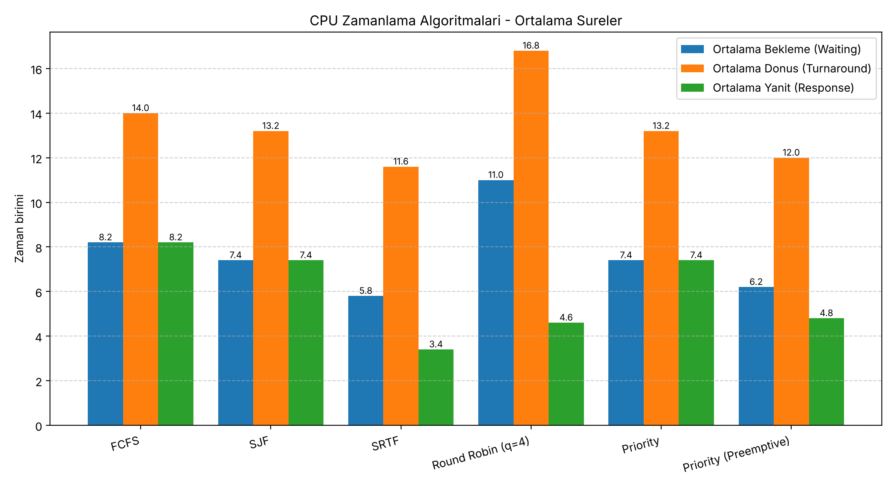
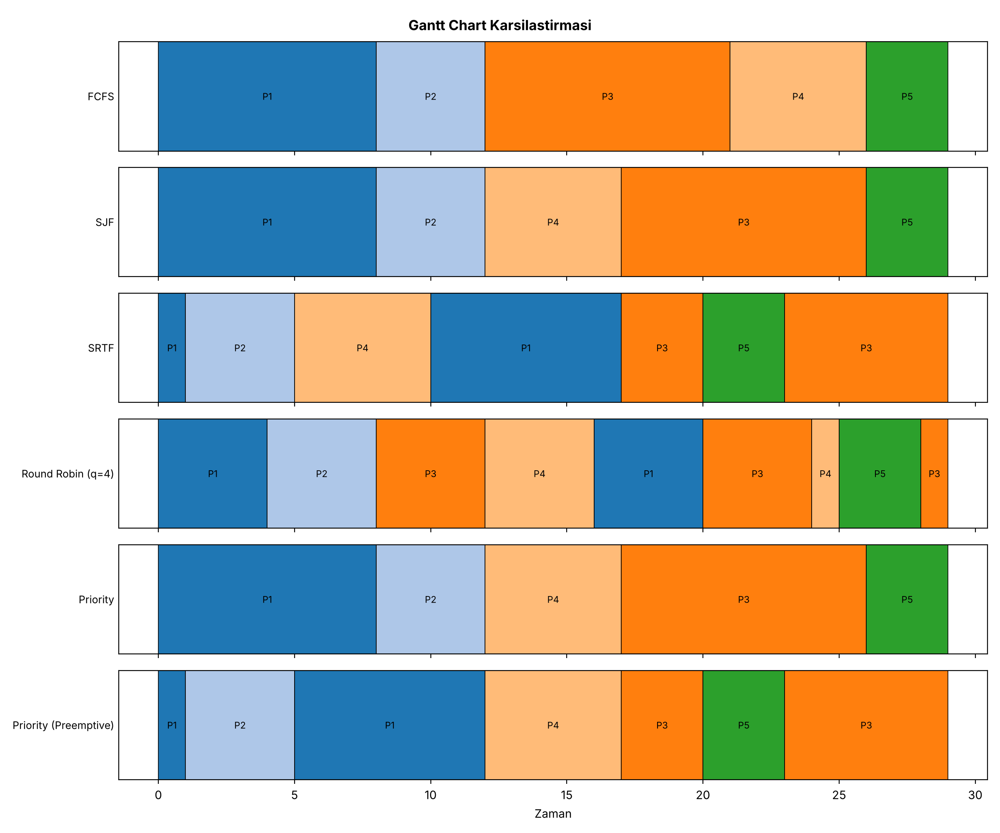

# CPU Scheduling Simulator

COME 361 – İşletim Sistemleri dersi (Chapter 6 – CPU Scheduling) dönem projesi.

Proje; **FCFS, SJF, SRTF, Round Robin ve Priority (non-preemptive + preemptive)** algoritmalarını simüle eder,
her biri için **waiting time, turnaround time ve response time** hesaplar, Gantt chart çıkarır,
algoritmaları karşılaştırır ve sonuçları CSV / rapor / grafik olarak dışa aktarır.

| Proje hedefi | Durum | Nerede |
|---|---|---|
| 1) Algoritmaları incelemek | ✅ | bu README (Algoritmalar bölümü), `docs/SUNUM_REHBERI.md` |
| 2) Algoritmaları simüle etmek | ✅ | `src/fcfs.cpp`, `sjf.cpp`, `round_robin.cpp`, `priority.cpp`, `preemptive.cpp` |
| 3) Waiting / turnaround / response hesaplamak | ✅ | her algoritma + `src/metrics.cpp` |
| 4) Algoritmaları karşılaştırmak | ✅ | `printComparison()` (terminal), `output/summary.csv` |
| 5) Analiz ve görselleştirme | ✅ | `cpu_project/visualizer.py` → `output/charts/*.png` |

---

## 1) Derleme ve çalıştırma

### A) Visual Studio (önerilen – Windows)

1. `CPU-Scheduling-Simulator.sln` dosyasını Visual Studio ile aç.
   *(VS "Projeyi yeniden hedefle / Retarget" sorarsa **Tamam** de – kendi Platform Toolset'ini seçer.)*
2. Üst çubukta **x64** ve **Debug** seçili olsun.
3. Başlangıç projesi **CPUSchedulingSimulator** olsun (Solution Explorer'da sağ tık → *Set as Startup Project*).
4. **Ctrl+F5** ile çalıştır → menü açılır.
   Komut satırı argümanı vermek için: *Proje → Özellikler → Debugging → Command Arguments* → `data/sample.txt --all --export`
5. Testler için: **SchedulerTests** projesini Startup yap ve Ctrl+F5.

> Çalışma klasörü otomatik olarak çözüm klasörüdür, bu yüzden `data/sample.txt` ve `output/` yolları sorunsuz çalışır.
> Program ayrıca farklı klasörlerden başlatılsa bile proje kökünü kendisi bulur.

### B) Visual Studio – "Klasör Aç" (CMake)

*Dosya → Aç → Klasör…* ile proje klasörünü aç. VS `CMakeLists.txt`'i tanır; hedef olarak `scheduler.exe` (veya `run_tests.exe`) seçip çalıştır.

### C) g++ / make (Linux, macOS, Windows-MinGW)

Gereksinimler: `g++` (C++11 veya üstü), `make`

```bash
make            # derle  -> ./scheduler
./scheduler     # menülü mod
make test       # birim testleri
make demo       # sample.txt ile hepsini çalıştır + output/ klasörüne yaz
make viz        # grafikleri üret (python3 + pandas + matplotlib)
make clean
```

`make` yoksa: `g++ -std=c++11 -Iinclude -o scheduler src/*.cpp`

### D) Python grafikleri için

```bash
pip install -r requirements.txt
python cpu_project/visualizer.py        # output/ klasöründeki CSV'leri okur
```

---

## 2) Kullanım

**Menülü mod**

```
./scheduler                    # menü ile
./scheduler data/sample.txt    # process'leri dosyadan yükleyip menü ile
```

**Menüsüz (toplu) mod – demo için ideal**

```
./scheduler data/sample.txt --all --export
./scheduler data/sample.txt --algo rr --quantum 3
./scheduler data/convoy_effect.txt --algo fcfs
./scheduler --help
```

| Seçenek | Açıklama |
|---|---|
| `--algo <ad>` | `fcfs`, `sjf`, `srtf`, `rr`, `priority`, `ppriority`, `all` |
| `--all` | Hepsini çalıştır + karşılaştırma tablosu |
| `--quantum <n>` | Round Robin time quantum (varsayılan 4) |
| `--export` | Sonuçları `output/` klasörüne yaz |
| `--out <klasör>` | Çıktı klasörünü değiştir |

### Girdi dosyası formatı

```
<process sayısı>
<arrival> <burst> <priority>     (her process için bir satır)
```

Priority'de **küçük sayı = yüksek öncelik**. Örnek: `data/sample.txt`

### Çıktılar (`output/` klasörü)

| Dosya | İçerik |
|---|---|
| `results.csv` | Her algoritma × her process: start, completion, waiting, turnaround, response |
| `gantt.csv` | Gantt chart dilimleri |
| `summary.csv` | Algoritma başına ortalama değerler, CPU kullanımı, context switch, throughput |
| `report.txt` | Terminal çıktısının aynısı (tablolar + Gantt + karşılaştırma) |
| `charts/*.png` | `visualizer.py`'nin ürettiği grafikler |

Örnek çıktılar `docs/ornek_cikti/` altında hazır durur.

---

## 3) Proje yapısı

```
include/process.h       Process, GanttEntry, SchedulingResult yapıları
include/scheduler.h     Algoritma fonksiyon imzaları (ortak arayüz)
include/input.h         Girdi fonksiyonları
include/export.h        CSV/rapor dışa aktarma + dosya yolu yardımcıları
src/main.cpp            Ana program, menü ve komut satırı
src/input.cpp           Klavye / dosyadan process okuma
src/fcfs.cpp            FCFS
src/sjf.cpp             SJF (non-preemptive)
src/round_robin.cpp     Round Robin
src/priority.cpp        Priority (non-preemptive)
src/preemptive.cpp      SRTF ve Priority (preemptive)
src/metrics.cpp         Ortalamalar, CPU kullanımı, tablo/Gantt yazdırma, karşılaştırma
src/export.cpp          CSV + rapor dosyaları
cpu_project/visualizer.py   Analiz ve grafikler (pandas + matplotlib)
tests/test_scheduler.cpp    Birim testleri
data/                   Örnek ve edge-case girdi dosyaları
docs/                   Sunum rehberi ve örnek çıktılar
CMakeLists.txt, *.sln, *.vcxproj, Makefile    Derleme dosyaları
```

Her algoritma aynı imzayı kullanır: `SchedulingResult runXXX(std::vector<Process> procs)`.
Process listesi kopya olarak alınır, böylece aynı girdi tüm algoritmalara verilebilir.
Her algoritma `start, completion, waiting, turnaround, response` alanlarını doldurur, `gantt` listesini oluşturur ve `computeMetrics(res)` çağırır.

---

## 4) Algoritmalar

| Algoritma | Tür | Seçim kuralı | Eşitlikte |
|---|---|---|---|
| FCFS | non-preemptive | Önce gelen | küçük PID |
| SJF | non-preemptive | En kısa burst | erken gelen, sonra küçük PID |
| SRTF | preemptive | En kısa **kalan** süre (yeni gelen daha kısaysa kesilir) | çalışan devam eder |
| Round Robin | preemptive | Sıra ile, her seferinde en fazla `quantum` kadar | kuyruk sırası |
| Priority | non-preemptive | En küçük priority sayısı | erken gelen, sonra küçük PID |
| Priority (Preemptive) | preemptive | Daha öncelikli process gelirse kesilir | çalışan devam eder |

**Metrikler**

- `Turnaround = Completion − Arrival`
- `Waiting    = Turnaround − Burst`
- `Response   = İlk CPU alış zamanı − Arrival`
- Ek olarak: CPU utilization, throughput, context switch sayısı (Gantt chart'tan hesaplanır)

CPU boş kaldığında Gantt chart'ta `IDLE` dilimi gösterilir.

---

## 5) Test senaryoları

`make test` (veya `SchedulerTests` projesi) şunları doğrular – **0 hata** ile geçer:

| Senaryo | Dosya | Neyi sınar |
|---|---|---|
| Temel senaryo | `data/sample.txt` | 6 algoritmanın elle hesaplanmış ortalamaları |
| Convoy effect | `data/convoy_effect.txt` | Uzun iş başta olunca FCFS: 17.00, SJF: 3.00 |
| SJF ders kitabı örneği | `data/sjf_classic.txt` | SJF sırası P1,P3,P2,P4 |
| **Edge:** başta CPU boş | `data/edge_idle_start.txt` | İlk dilim `IDLE (0-3)` |
| **Edge:** ortada CPU boş | `data/edge_idle_gap.txt` | Ortada `IDLE` dilimi |
| **Edge:** aynı arrival + eşitlik | `data/edge_same_arrival.txt` | Deterministik sıralama |
| **Edge:** tek process | `data/edge_single.txt` | waiting = response = 0 |
| Büyük girdi | `data/large_10.txt` | 10 process, tüm kurallar |
| Quantum çok büyük / quantum=1 | testte | RR(q büyük) = FCFS |
| Hatalı girdi | testte | Eksik dosya, negatif burst, eksik satır reddedilir |
| 300 rastgele senaryo | testte | Her algoritma için tüm formüller, Gantt tutarlılığı, "SRTF ortalama waiting'i en küçük yapar" kuralı |

### Örnek sonuç (`data/sample.txt`, q = 4)

| Algoritma | Avg Waiting | Avg Turnaround | Avg Response | Context Switch |
|---|---|---|---|---|
| FCFS | 8.20 | 14.00 | 8.20 | 4 |
| SJF | 7.40 | 13.20 | 7.40 | 4 |
| SRTF | **5.80** | **11.60** | **3.40** | 6 |
| Round Robin (q=4) | 11.00 | 16.80 | 4.60 | 8 |
| Priority | 7.40 | 13.20 | 7.40 | 4 |
| Priority (Preemptive) | 6.20 | 12.00 | 4.80 | 6 |




**Yorum:** SRTF ortalama bekleme/dönüş süresinde en iyi, ama daha fazla context switch yapar.
Round Robin'in ortalama bekleme süresi en yüksektir; buna karşılık response time'ı FCFS/SJF'ten çok daha iyidir
(her process hızlıca CPU'yu görür) – interaktif sistemler için bu önemlidir.

---

## 6) Görev dağılımı

| Üye | GitHub | Modül | Durum |
|---|---|---|---|
| Kişi 1 | lalekeles | Ana sistem (`main.cpp`), Process yapısı, kullanıcı girişi, FCFS, entegrasyon | ✅ Tamam |
| Kişi 2 | Eliftskn | SJF (`sjf.cpp`) ve SJF test senaryoları | ✅ Tamam |
| Kişi 3 | *(isim eklenecek)* | Round Robin (`round_robin.cpp`) | ✅ Tamam |
| Kişi 4 | *(isim eklenecek)* | Priority Scheduling (`priority.cpp`) | ✅ Tamam |
| Analiz & görselleştirme | gülsüm eskipınar | `cpu_project/visualizer.py` | ✅ Tamam (C++ çıktısına bağlandı) |

Final entegrasyonunda eklenenler: preemptive algoritmalar (SRTF, Priority-Preemptive), CSV/rapor dışa aktarma,
komut satırı modu, ek ölçümler (CPU utilization, context switch), birim testleri, Visual Studio / CMake proje dosyaları, dokümantasyon.

## 7) Branch'ler

| Branch | Açıklama |
|---|---|
| `main` | Entegre ve çalışan sürüm |
| `birlestirme` | Round Robin + ortak arayüze geçiş (PR #1, #2 ile main'e alındı) |
| `priority` | Priority scheduling (PR #3 ile main'e alındı) |
| `sjf`, `sjf-duzeltme` | SJF çalışması (PR #4 ile main'e alındı); `sjf` eski dosya düzenini içerir |

## 8) Bilinen sınırlamalar

- Priority'de **aging** yoktur; düşük öncelikli process'ler starvation yaşayabilir (bilinçli sadelik).
- Context switch maliyeti 0 kabul edilir (sadece sayısı raporlanır).
- Zaman birimleri tamsayıdır, I/O burst'ü modellenmez.
